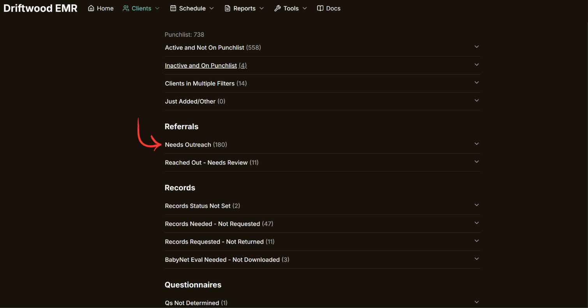

<big>**When it's time for a greeter to reach out to a prospective client, it is important that each greeter is claiming the client under the *Needs Outreach* section of the client Dashboard.**</big>

<big>This takes almost no time but saves us a lot of hassle and wasted time by preventing us from performing Outreach twice.</big>

## Claiming Outreach

Every time you intend to reach out to a client, it is incredibly important to "claim" that client for outreach. Not doing so means that no one else will know that you intend to reach out to the new client.

To claim a client under outreach, simply click the "Claim" button on the right-hand side for the appropriate client.

This will automatically update the page to show that you've claimed it (as shown below). This is visible for everyone that looks at this list, so we can prevent doubling up on client outreach.

## Unclaiming Outreach

If you, for any reason, need to "unclaim" a client, simply click the "Unclaim" button that replaced the original "Claim" button. This will remove the claim, and remove your name from next to the client, so anyone else can see that it's okay to initiate outreach for that client.

