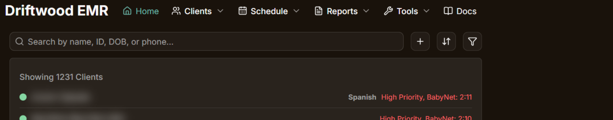
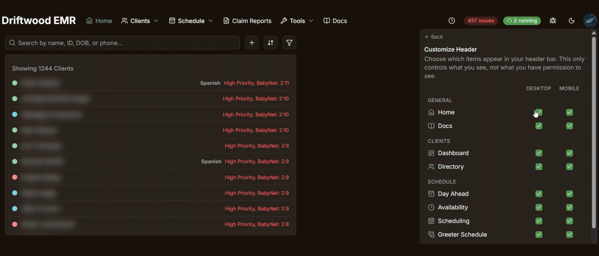
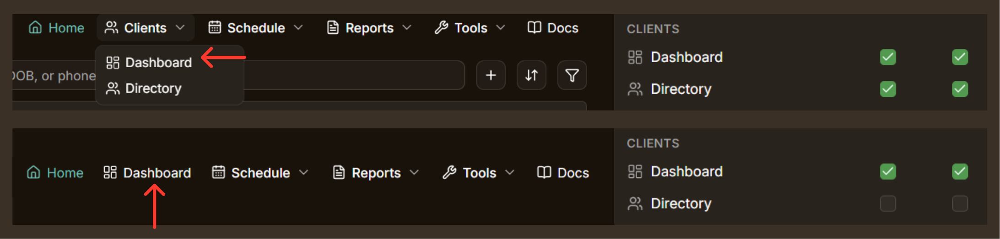

This page will explain how you can customize your EMR header, or the Navigation bar. To learn more about the basics of the Nagivation Bar itself, [click here](navigation-bar).

Customizing your header means that you can hide any of the default options that are available to you, allowing for a setup that is more optimal for your specific needs. This way, you can hide things that you may not use, and leave only the things you actually use day to day.

>[!INFO] Customizing your header changes what you *see*, nothing else: you keep every permission you had, and you can still reach a hidden page by typing its address into the browser.

## Accessing the "Customize Header" Menu

Click your profile picture in the top right corner, then **Customize Header**. 

The menu switches to the customizer panel; the **Back** arrow at the top returns to the account menu.

Anyone signed in can open it. Changes save on their own as you make them, there's no Save button.

You can also change the same header options from **Settings**, on the **My Preferences** tab. That tab also holds your home page widgets and the order of your Issues page lists, and anything you change there matches what you see in the header menu.

## The "Customize Header" Menu

While not everyone has access to all of the same items, every item you do have access to is listed in the "Customize Header" menu. Except for the Theme Switcher, which is not present on the mobile EMR, each item listed has two checkboxes next to it: **Desktop** and **Mobile**. A checked box means the item shows on that layout.

- **Desktop** is the full top bar you see on a computer.
- **Mobile** is the menu reformatted to fit mobile devices or narrow windows

>[!HINT] Tip - The Mobile menu is found by tapping on the 3 stacked lines in the top left corner of the screen, also known as a hamburger menu.

Click a checkbox to show or hide that item on just that layout. Click the item's **name** instead to flip it on or off for both layouts at once. To bring a hidden item back, open this panel again and re-check its box (or click its name).

## What you can hide

**Navigation links**

| Group | Items |
|---|---|
| General | Home, Docs |
| Clients | Dashboard, Directory |
| Schedule | Day Ahead, Greeter Schedule, Availability, Scheduling |
| Reports | Claim Reports, Report Dashboard* |
| Tools | Fax Categorization, Work Summary, Calculator, Questionnaire Logins |

> [!INFO] "Report Dashboard" may be listed under the evaluator's name (ex. "Andrew's Reports").

**Actions**

Client Search, Recent Clients, Issues Alert, Task Queue, Acting As, PII Redaction Toggle, Theme Switcher, Report an Issue.

> [!INFO] Only items you can use appear in the list, so what you can see and hide will likely not have all of the options listed above.

## How hidden links behave on desktop

On the desktop bar, the **Clients**, **Schedule**, **Reports**, and **Tools** groups are dropdown menus. If you hide every link in one of those groups, the whole dropdown disappears. If you hide all but one, the group collapses to a single button that links to that specific page.

## Important Reminders & Notes

- **Hiding an item is not the same as losing access.** The page is still there; you just navigate to it directly instead of from the header. Your permissions don't change.
- **Theme Switcher only has a Desktop checkbox.** The light/dark toggle isn't part of the mobile menu, so there's nothing to hide there.
- **A couple of items have their own show/hide rules on top of your setting.** Client Search never shows on the Home page, no matter what its box says (since the Home page has its own big search). Recent Clients only shows after you've opened at least one client's page. Unchecking either one here hides it everywhere, but checking it back on doesn't override those built-in rules.
- **Desktop and Mobile are independent.** Hiding something on one layout leaves it on the other unless you also uncheck that box (or use the name toggle, which does both).
