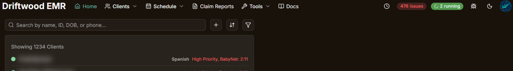
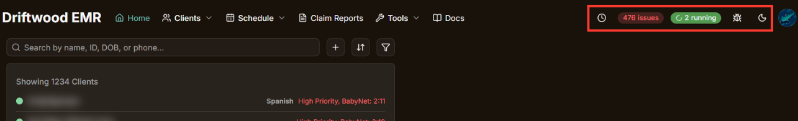

No matter what page you are on in the EMR, the Navigation bar will always be at the top of the page. While the Navigation bar is customizable, ([click here to learn how to customize it!](header-customization)) this page will explain the basics of the navigation bar, and serve as a starting point to learn more about the rest of the EMR

## EMR Sections

The Navigation Bar by default is broken up into sections, including:
- [Home](#home)
- [Clients](#clients)
- [Schedule](#schedule)
- [Reports](#reports)
- [Tools](#tools)
- [Docs](#docs)
- [Actions](#actions)

## Home

The **Home** button will take you back to the Home page.

- [Intro to your Home Page](intro-to-home)

## Clients

- [Dashboard](dashboard)
- [Directory](directory)
- [Questionnaires](questionnaires)

## Schedule

#### Day Ahead
- [Day Ahead](day-ahead)
- [Arrivals and Departures](arrivals-and-departures)

#### Availability
- [Availability](availability)

#### Scheduling
- [Scheduling](scheduling)

#### Greeter Schedule
- [Greeter Schedule](greeter-schedule)

## Reports
- [Claim Reports](claim-reports)

## Tools
- [Fax Categorization](fax-categorization)
- [Logins](logins)

## Docs

## Actions

All Action Items are icons and buttons found on the righthand side of the Navigation bar

#### Client Search

The client search action item is only visible on the Navigation Bar if you are not on your home page. The client serach function in the Navigation bar is functionally identical to the client search on the Home Page. Learn more about searching for clients works [here](intro-to-home#the-search-bar).

To use the client search action item, click on the magnifying glass or where is says Ctrl + K, or press Ctrl and K simultaniously on your keyboard to bring up the search menu.

Just like on your Home Page, the client search menu shows the list of clients, the search bar, and the recent clients list. However, in this menu, you can only filter by "Active" or "Inactive", so if you need to filter more specifically, you must return to your home page and search from there.

#### Recent Clients

The Recent clients action item, simply gives you a dropdown list of clients you have viewed recently, which is especially helpful if you need to quickly and easily get back to a client page that you recently viewed.

#### Issues Alert

- [Issues Alert](issues-alert)

#### Task Queue

The Task Queue is simply a dropdown list of current Background tasks happening within the EMR, such as sending out Questionnaire reminders, or the program that categorizes faxes.

#### Report an Issue

The Report an Issue action item is symbolized with a little bug icon. Hovering over it shows a menu with Create bug report, Create feature request, and My bug reports. Clicking the icon itself starts a bug report: it takes a screenshot of the page you are on and opens a form where you choose Bug or Feature request, describe what you need, and pick a priority from Highest to Lowest (Medium by default). Bug reports need at least one image, and feature requests do not. Besides taking more screenshots, you can use Upload image, or paste an image from your clipboard into the form (for example, one you took with your computer's screenshot tool), to add your own pictures (up to 5 images in total) and mark them up the same way. You can also include colleagues on the email. Your report is sent to tech@ from your own email, with a ticket number in the subject once it has been logged. To check on a report, open My Bug Reports in the navigation bar: it shows each report you sent, or were included on, with its ticket number and current status. A new report shows as Submitted until it has been picked up. For updates and replies, search your email for the ticket number. People with the Issue Report Admin permission also see a Show all reports button there, which lists every report from everyone along with who sent it and who was included on it.

#### Theme Switcher

The Theme Switcher allows you to switch between light mode and dark mode, or "system" mode, which will set the EMR theme to change according to your device settings (ex. if you have your computer set to be in dark mode when the battery gets low, the EMR will change too)

