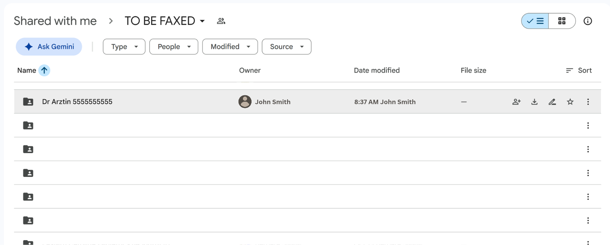
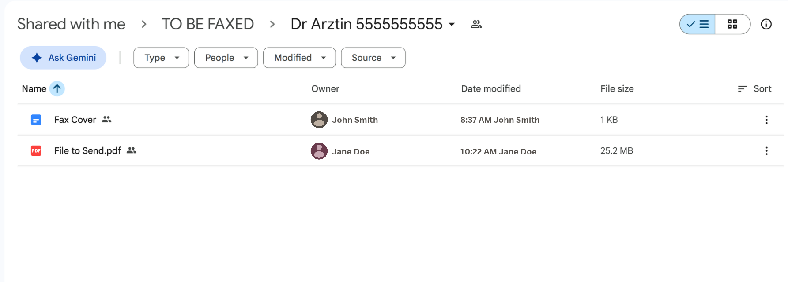
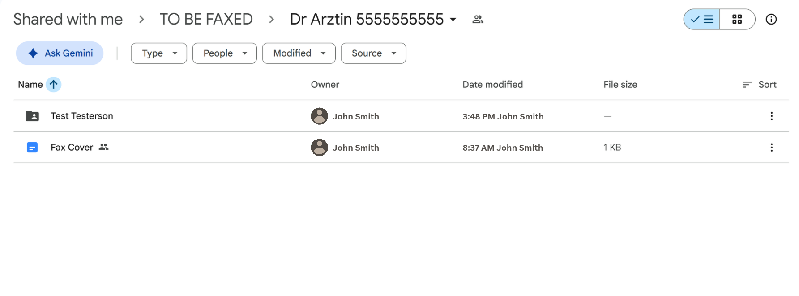
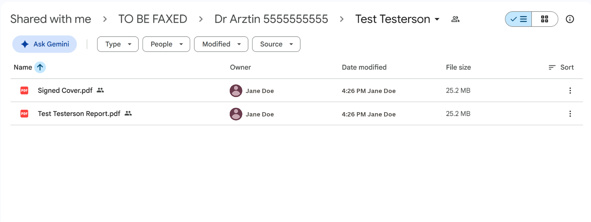

<big>Faxing a report is done via the "TO BE FAXED" folder on Google Drive.</big>

> [!QUESTION]~ **Note:** These screenshots exclude any actual doctor or client information. Usually the folder will be amongst a list of all doctors that we have fax information for.

The first step to faxing is to locate the folder that has the correct Doctor information and fax number. **For HIPAA reasons, it is very important that this number is correct, otherwise private client information <u>will</u> be sent to the wrong place.**

Once you have located the correct folder, you can open the folder to see a file named "Fax Cover". This is required and part of all fax reports because it hides sensitive client information from being immediately on top when a fax comes through.

For basic report faxing, you just need to upload, or drag and drop, the report file into this folder with the Fax Cover. The automated system will then automatically send any necessary faxes at **10pm**. *This means the fax will not immediately be sent over, but it will be sent later that night.*

In some cases, more information, or a special hand signed report cover may be required by the other office. In these cases, you must create a new folder inside the office's folder named with the client's name, such as the "Test Testerson" folder below. Inside this folder is where you will place the documents to be faxed instead.

The documents to be faxed must then be placed into the named client folder. Place the signed cover file and the client report into this folder and the fax will be sent as usual at **10pm**, this time including the signed fax cover.

> [!Warning]~ The file in this folder that has the word "report" in it will be sent **last**, so make sure the files are named accordingly so that the signed cover is sent first, with the client report sending after.

