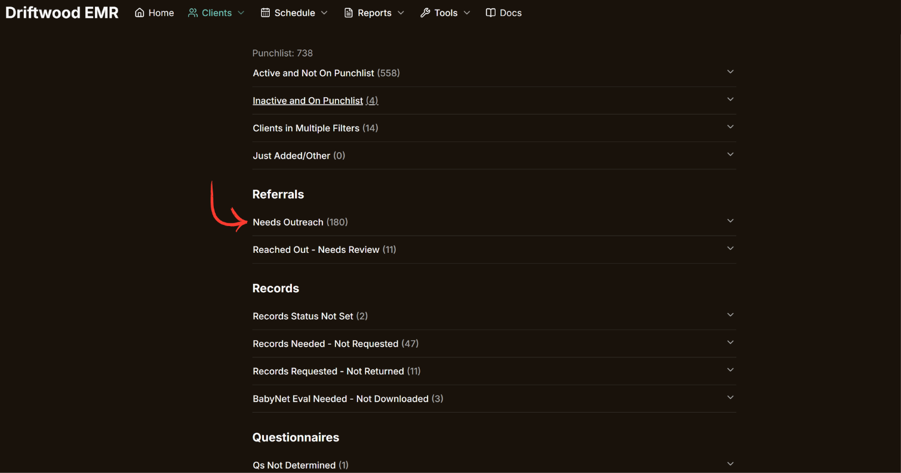
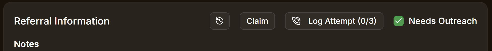
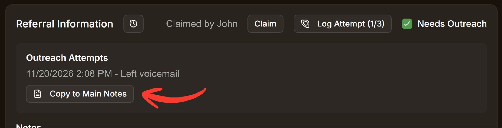

<big>The Outreach Process is how staff track phone contact with referred clients who are in TherapyAppointment but not yet on the Client Prioritization sheet (punchlist).</big>

## 1. Flagging a client for outreach

On intake, staff check the **Needs Outreach** box on the client's Referral tab. *Learn more about the client Referral tab [here](client_referral).*

 

Active clients with **Needs Outreach** checked appear on the Dashboard's **Needs Outreach** section. **Needs Outreach** is sorted in the following manner:
- By added date, clients added the longest ago are at the top
- An attempt to contact logged in the past 21 days pushes the client to the bottom
- 3 logged attempts to contact drops the client from the list entirely, moving them to the [**Drop List**](drop_list).

## 2. Needs Outreach Claiming Process

<big>From the dashboard or the Referral tab, staff can claim a client, which adds the claimer's name onto the dashboard so it's clear who made the most recent outreach call.</big>

> [!tip] It is good customer service to handle return calls from clients immediately rather than tagging the person who made the outreach call. If you answer the phone for a client we recently reached out to, please complete the outreach process at that time, rather than creating another phone call loop of us calling the client back and them potentially needing to call us again.

<big>**When it's time for a greeter to reach out to a prospective client, it is important that each greeter is claiming the client under the *Needs Outreach* section of the client Dashboard.**</big>

<big>This takes almost no time but saves us a lot of hassle and wasted time by preventing us from performing Outreach twice.</big>

### Claiming Outreach

Every time you intend to reach out to a client, it is incredibly important to "claim" that client for outreach. Not doing so means that no one else will know that you intend to reach out to the new client.

To claim a client under outreach, simply click the "Claim" button on the right-hand side for the appropriate client.

This will automatically update the page to show that you've claimed it (as shown below). This is visible for everyone that looks at this list, so we can prevent doubling up on client outreach.

### Unclaiming Outreach

If you, for any reason, need to "unclaim" a client, simply click the "Unclaim" button that replaced the original "Claim" button. This will remove the claim, and remove your name from next to the client, so anyone else can see that it's okay to initiate outreach for that client.

## 3. Logging an attempt

<big>After attempting outreach, *if the attempt was unsuccessful*, it is important to be logging the attempt. This is done by clicking the **Log Attempt** button, also under the Referral tab.</big>

The **Log Attempt** button opens a popup with a notes field. Submitting it records who made the attempt, when, and any notes, added onto that client's attempt history.

> [!NOTE]~ This is where you should say "Left a voicemail" or "Spoke to mother of client, she was driving and scheduled a callback at 2:15 today" or otherwise relevant information about the unsuccessful attempt.

The **Copy to Main Notes** button under the attempt list adds each logged attempt to the end of the client's note. Clicking it again only adds attempts that are not already in the note.

## 4. After 3 attempts

Once 3 attempts are logged without success, the client drops off the **Needs Outreach** list and instead shows up on the **Drop List** (reason: "Outreach attempts exhausted") for review.

> [!WARNING] If the third attempt is successful, make sure you are not logging the attempt. Logging the attempt will push the successful outreach to the client drop list, rather than pushing it forward for review

## 5. Resolving

From the Referral tab, staff can also mark a client **for review**, meaning outreach has been completed, and the client is no longer claimable or loggable. This will allow another staff member to "Push to Punch".

This button is found at the very bottom of the referral tab, at the end of the Outreach script, and should be used once a successful outreach attempt is completed.

